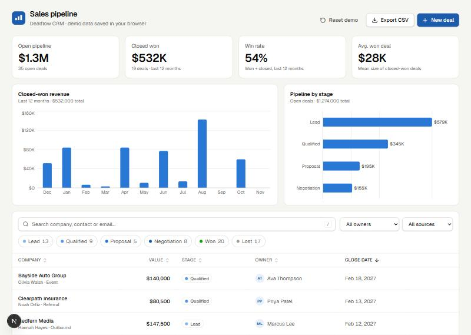

# Dealflow — Sales Pipeline CRM

A mini-CRM dashboard for tracking sales deals, built with **Next.js 16, React 19 and TypeScript**.
It's a portfolio project focused on clean state management and a polished, accessible UI.



## Features

- **KPI cards** — open pipeline, closed-won revenue, win rate and average deal size
- **Charts** — monthly closed-won revenue and open pipeline by stage (Recharts, with tooltips)
- **Deals table** — sortable columns, pagination, overdue badges, row click to edit
- **Search & filters** — full-text search (company, contact, email), multi-select stage chips with live counts, owner and source filters
- **Everything is reactive** — KPIs and charts recalculate for whatever the filters show
- **Create / edit / delete** — modal form with validation, inline errors and focus on the first invalid field
- **Undo** — deleting a deal or resetting the demo shows a toast with an Undo action
- **Persistence** — data is saved to `localStorage`; "Reset demo" regenerates the sample dataset
- **CSV export** of the filtered, sorted list (with spreadsheet formula-injection protection)
- **Keyboard shortcuts** — `/` focuses search, `N` opens a new deal
- **Dark mode** (follows the OS setting) and a responsive layout down to phone width

## State management

All app data lives in a single `useReducer` store exposed through React Context
([`src/state/DealsProvider.tsx`](src/state/DealsProvider.tsx)).

| Layer | Where | Notes |
|---|---|---|
| Domain state | `dealsReducer` | Pure reducer: `add`, `update`, `delete`, `restore`, `reset`. Never mutates; unchanged rows keep object identity |
| UI state | `Dashboard` component | Filters, sort, page, dialog and toast — local `useState`, because nothing else needs them |
| Derived data | `src/lib/selectors.ts` | Filtered rows, KPIs and chart series are **computed**, never stored, so they can't get out of sync |

A few details worth pointing out:

- **`useDeferredValue`** keeps the search input instant while filtering and charts re-render at lower priority.
- **Undo without extra state:** `deleteDeal()` returns a closure that dispatches `restore` with the deal's original index.
- **No hydration mismatch:** the dashboard is loaded with `next/dynamic({ ssr: false })`, so the reducer's lazy
  initializer can read `localStorage` directly instead of syncing in an effect.
- **Seeded demo data:** a deterministic PRNG generates the same realistic pipeline on every reset,
  with dates relative to today so the charts always cover the last 12 months.
- The add/edit form uses the native **`<dialog>`** element for focus trapping, `Esc` to close and an inert background.

## Tech stack

Next.js 16 (App Router) · React 19 · TypeScript (strict) · Tailwind CSS 4 · Recharts · lucide-react · Vitest

## Getting started

```bash
npm install
npm run dev        # http://localhost:3000
```

Other scripts:

```bash
npm test           # unit tests (reducer, selectors, validation, CSV)
npm run typecheck  # tsc --noEmit
npm run lint
npm run build
```

## Project structure

```
src/
  app/                 # Next.js layout and page
  components/          # Dashboard, Toolbar, DealsTable, DealDialog, Charts, KpiCards, Toast, ui
  state/               # DealsProvider (Context + useReducer + localStorage)
  lib/                 # Pure logic: types, reducer, selectors, validation, seed data, CSV, formatting
```

All business logic is in `src/lib` as plain functions, so it's unit-tested without rendering any React.

---

All companies and people in the demo data are fictional.
